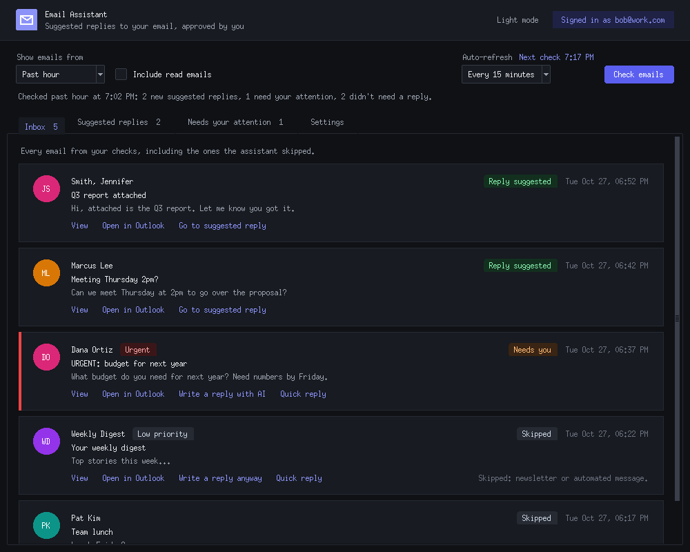
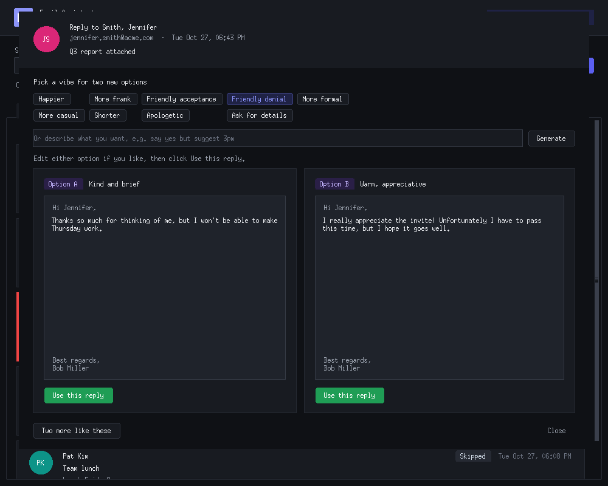
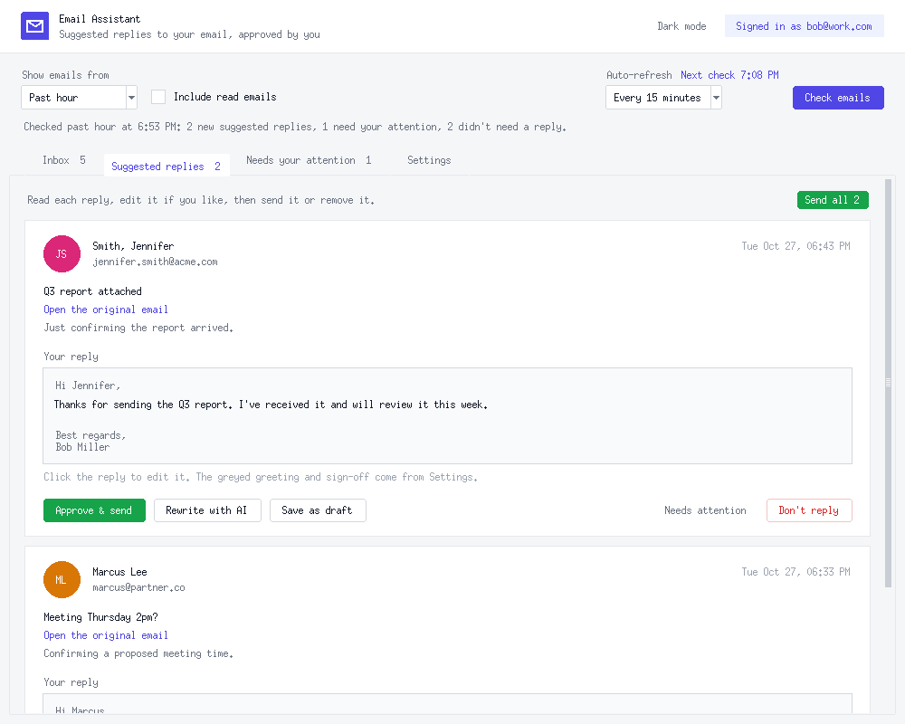

# Email Assistant

**Suggested replies to your work email, written by an AI on your own PC and sent only when you approve them.**

Email Assistant checks your inbox, drafts replies to the easy emails, flags the ones that need a real answer from you, and lets you review, edit and send each reply in a couple of clicks. The AI runs locally, so your email is never sent to an AI company.

**[⬇ Download Email Assistant](https://github.com/kefirman9000/email-assistant/archive/refs/heads/stable.zip)** · Windows 10 or 11 · Free

## Features

- **Suggested replies** to simple emails (thank-yous, meeting confirmations, quick yes/no questions), ready to edit and send
- **Reply picker** with two AI options side by side, plus one-click vibes: *Happier, More frank, Friendly acceptance, Friendly denial, More formal, Shorter* and more
- **Quick replies** for one-click answers like "Thanks, got it!", no AI needed
- **Your greeting and sign-off** added automatically, with an on/off switch for any reply
- **Inbox view** of every email, with urgency labels and a built-in email viewer
- **Auto-refresh** every 5 to 60 minutes, with **Windows notifications** when emails need you
- **Natural sending pace**: replies go out one at a time with a short random pause, so nothing looks automated
- **Dark mode**, and updates that only install when you say yes

**Nothing is ever sent without you clicking Approve & send.**

## Getting started

You'll need **[Python](https://www.python.org/downloads/)** (tick *Add python.exe to PATH* while installing) and **[Ollama](https://ollama.com/download)**, the free program that runs the AI on your PC.

1. **[Download Email Assistant](https://github.com/kefirman9000/email-assistant/archive/refs/heads/stable.zip)** and unzip it somewhere like your Documents folder.
2. Double-click **Setup.bat** and wait for *All done!* The first AI download can take a while.
3. Double-click **Start Email Assistant**. Tip: right-click it → *Send to* → *Desktop (create shortcut)*.
4. On the **Settings** tab, enter your name, choose your **Connection** (below), check your greeting and sign-off, and click **Save settings**. Then click **Test connection**.

### Choosing a connection

| | **Microsoft account** (recommended) | **Classic Outlook on this PC** |
|---|---|---|
| Works with | New Outlook, classic Outlook, Outlook on the web | Classic Outlook desktop app only |
| Setup | Your IT department approves the app once, then you sign in | Nothing extra |
| Outlook must be open | No | Yes |

For **Microsoft account**, enter the two codes from IT under **Settings → Connection** and click **Sign in**. Send IT the [IT setup](#it-setup) steps below.

## Using it

1. Choose a time range under **Show emails from**, then click **Check emails**. Or set **Auto-refresh** to check on its own.
2. **Inbox** shows every email and what the assistant decided. Click **View** to read one, or **Write a reply with AI** for any email, even skipped ones.
3. **Suggested replies**: edit the text if you like, then **Approve & send**. Or try **Rewrite with AI**, a **Quick reply**, or **Save as draft** to finish in Outlook.
4. **Needs your attention** holds emails the assistant couldn't safely answer. **Draft a reply with AI** lets you pick a vibe like *Friendly acceptance* or *Friendly denial*.

Everything else, from notifications to sending pace and quick replies, is under **Settings**.

## Updates

When a new version is out, an orange **Update available** button appears at the top of the window. Click it to see what's new, then choose **Yes** to install. Nothing installs without your OK, and your settings and replies are kept. You can also click **Check for updates** at any time.

## Troubleshooting

<b>"The AI program (Ollama) isn't running"</b>

Open **Ollama** from the Start menu, wait a few seconds, then try again. If it says the AI model isn't downloaded, run **Setup.bat** again.

<b>"You're using the NEW Outlook" (Classic Outlook connection)</b>

The new Outlook doesn't let other programs connect to it. Switch to **Settings → Connection → Microsoft account** instead.

<b>"Outlook can read your mail but won't let programs create new emails"</b>

Your copy of Office probably isn't activated, so Outlook won't let anything create new emails, even by hand. Use the **Microsoft account** connection instead.

<b>Sign-in errors (Microsoft account)</b>

The message tells you what's wrong. Most often IT still needs to approve the app, or one of the two codes in **Settings → Connection** was copied incorrectly.

<b>No notifications appear</b>

Click **Send a test notification** under **Settings → Notifications**. If nothing shows up, turn notifications on in **Windows Settings → System → Notifications**. Some companies block them.

## Privacy

Your email stays between your PC and Microsoft. The AI runs on your own computer through Ollama, and your settings, replies and sign-in are stored only in the app's folder. The sign-in is encrypted by Windows.

## IT setup

*Only needed for the Microsoft account connection.*

<b>Steps for your Microsoft 365 administrator (about 5 minutes)</b>

**What the app is:** a desktop program on the user's PC. It signs in as the user (delegated permissions only) and reads and replies to **that user's own mailbox**. Its AI runs locally through Ollama. There is no server, and no mail content is sent anywhere except Microsoft.

1. In the **Microsoft Entra admin center**, go to **Identity → Applications → App registrations → New registration**.
   - **Name:** Email Assistant
   - **Supported account types:** Accounts in this organizational directory only (single tenant)
   - **Redirect URI:** platform **Public client/native (mobile & desktop)**, value `http://localhost`
2. On the app's **Authentication** page, set **Allow public client flows** to **Yes**. Save.
3. On **API permissions**, choose **Add a permission → Microsoft Graph → Delegated permissions** and add:
   - `User.Read`: see who is signed in
   - `Mail.ReadWrite`: read the inbox, create reply drafts, mark emails read and tag them "AI Replied"
   - `Mail.Send`: send the replies the user approves
   - `offline_access`: stay signed in between sessions
4. Click **Grant admin consent** for your organization.
5. Give the user the **Application (client) ID** and **Directory (tenant) ID** from the app's **Overview** page.

Conditional Access and MFA apply as normal. Users can remove the app's access at <https://myapps.microsoft.com>, and admins can delete the app registration at any time.

